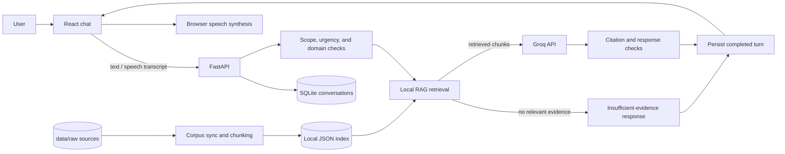

# Architecture

This document describes the implementation as it exists today. Configuration and operating instructions are in the [project guide](project-guide.md).

## System overview



The legal index, retrieval code, and classifier operate locally. Generated answers and long-history summaries use Groq. The browser sends text to the API; it does not send an audio recording. Qwen/Ollama code is isolated in evaluation scripts and is not part of the serving path.

## Request lifecycle

1. **Conversation lookup.** `POST /api/chat` uses the supplied conversation UUID or creates a new conversation. A reused `request_id` returns the saved result for the same message and rejects a different message.
2. **Request checks.** A deterministic gate rejects obvious off-topic and override requests. A local semantic classifier labels other requests as legal, non-legal, or ambiguous. Issue and situation extractors add routing and urgency hints; they do not decide legal liability.
3. **Conversation context.** Recent messages are loaded from SQLite. Earlier user questions help contextualize follow-ups. For questions that refer to the latest assistant reply, that reply can be added to the search query as a bounded, unverified retrieval hint. It is not legal evidence.
4. **Retrieval.** The query is expanded with issue hints and searched in the local index. Retrieval results below `RETRIEVAL_MINIMUM_RELEVANCE` are discarded. If none remain, the API returns a fixed insufficient-evidence response without calling Groq.
5. **Grounded generation.** The prompt contains the exact current question, structured situation hints, current retrieved chunks with source metadata, the citation-ID allowlist, and bounded recent history. Prior conversation is unverified context only.
6. **Output checks.** Citation IDs must belong to retrieved chunks. Deterministic checks reject certain unsupported section and punishment details and a response-scope validator blocks specific categories of off-scope output. These checks are not a complete semantic or legal verifier.
7. **Persistence and rendering.** The backend adds the standard disclaimer and atomically saves a completed user/assistant turn. The frontend renders the answer, source metadata, urgency state, and errors; optional browser speech synthesis reads the response text.

Immediate-danger matches are handled before retrieval and generation with a short safety-first response. Rate-limit and provider failures return fixed status messages. The in-memory session limiter is a prototype safeguard, not a distributed quota service.

## Retrieval pipeline

```text
Official/local source files → text extraction → section-aware chunks → JSON index
Question + context hints → BM25 + local term-vector similarity + optional dense search
→ reciprocal-rank fusion → optional local cross-encoder → relevance cutoff → evidence chunks
```

`backend/app/retrieval/corpus.py` tracks source hashes and only reprocesses new or changed files. `ingest.py` extracts PDF, text, Markdown, or JSON content and attaches provenance metadata. `chunker.py` creates section-aware chunks. `index.py` writes the JSON index under `data/vector_store` by default.

At query time, BM25 and the project's normalized term vectors provide lexical matches. When the `all-MiniLM-L6-v2` model is cached locally and dense retrieval is enabled, semantic scores are also used. Rank lists are fused with reciprocal-rank fusion. A cross-encoder reranker is optional and disabled by default. If a local sentence-transformer model is unavailable, the search path logs a warning and uses remaining local signals.

The relevance cutoff means “the retriever found a text match above this setting.” It does not mean “the evidence is legally sufficient.” Conversely, abstention can reflect missing corpus coverage. The index is a local JSON file; there is no remote vector database.

### Citation and validation boundary

Each chunk has a stable chunk ID and source metadata. The model is given the IDs it may cite. Citation validation rejects missing/unknown IDs and checks section references against retrieved material. A narrow deterministic claim check can reject some unsupported punishment amounts. The response-scope validator handles selected off-topic patterns.

These checks improve consistency but cannot prove that each legal proposition follows from the cited passage, that a statute is current, or that it applies to a person's facts. Citation presence is not proof of legal correctness. Manual legal review and representative corpus-based evaluation remain necessary.

## Classifier and guards

`ObviousOutOfScopeGate` rejects clear non-legal or instruction-override requests without a provider call. The semantic domain classifier uses local MiniLM embeddings with a Logistic Regression model saved under `data/domain_classifier/model`. Its legal/non-legal probability thresholds are configurable; requests between them are ambiguous. If its model files are unavailable, it conservatively returns ambiguous.

`LegalIssueClassifier` and `SituationUnderstander` use lightweight patterns and extraction to provide retrieval and urgency hints. Neither determines an offence or gives a legal finding. `ResponseScopeValidator` performs deterministic scope checks on model output; it is not semantic fact-checking.

## Conversations and API

The `ConversationStore` persists turns in SQLite and saves each successful pair atomically. The API exposes:

- `GET /health`
- `POST /api/conversations`
- `GET /api/conversations/{conversation_id}`
- `DELETE /api/conversations/{conversation_id}`
- `POST /api/chat`

Recent history is capped by `CONVERSATION_HISTORY_LIMIT` (default 6 messages, allowed range 2–10). When older turns roll past that window, the service asks the configured provider to summarize earlier **user statements only**. The summary is marked unverified context, not evidence. Conversation contents and relevant context are stored locally, but recent messages, summaries when generated, the current question, and retrieved chunks are sent to Groq for inference.

The API has no authentication or per-user ownership controls. Anyone able to submit a valid conversation ID may access or delete that conversation. The session request counter is also process-local and resets when the backend restarts. These are prototype limitations.

## Provider boundary

`LLMProvider` is the provider interface; `GroqProvider` is the only implementation selected by `create_provider`. `LLM_MODEL`, `GROQ_API_KEY`, and `GROQ_BASE_URL` configure it. There is no Ollama adapter in the application runtime. Local Qwen scripts inject their own benchmark provider and are deliberately separate from production configuration.

## Main code map

| Path | Responsibility |
| --- | --- |
| `backend/app/main.py` | FastAPI app, routes, conversation context, request orchestration. |
| `backend/app/services.py` | Retrieval-to-generation service, grounding and response checks. |
| `backend/app/prompts.py` | System prompt and grounded message assembly. |
| `backend/app/conversations.py` | SQLite schema, conversation operations, idempotent turn storage. |
| `backend/app/llm/` | Provider interface, Groq implementation, and provider factory. |
| `backend/app/domain_guard/` | Deterministic request gate, semantic domain classifier, response-scope validator. |
| `backend/app/situation/` and `issue_classifier.py` | Non-adjudicative routing and urgency hints. |
| `backend/app/retrieval/` | Source sync, ingestion, chunking, local index, search, and evaluation helpers. |
| `frontend/src/App.tsx` | Chat UI, conversation actions, citations, speech controls. |
| `frontend/src/services/chat.ts` | Browser API client and request/response types. |

See the [project guide](project-guide.md) for setup, configuration, and commands.
